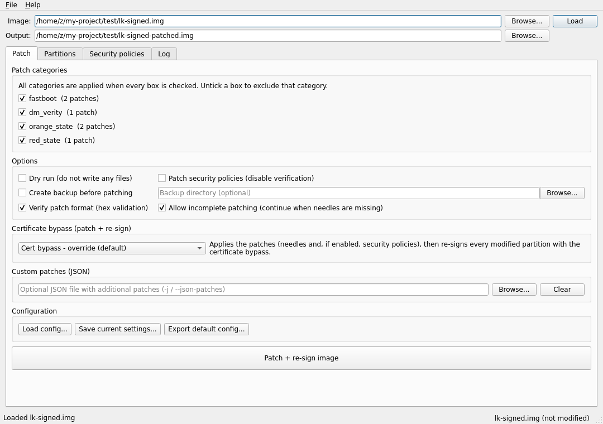
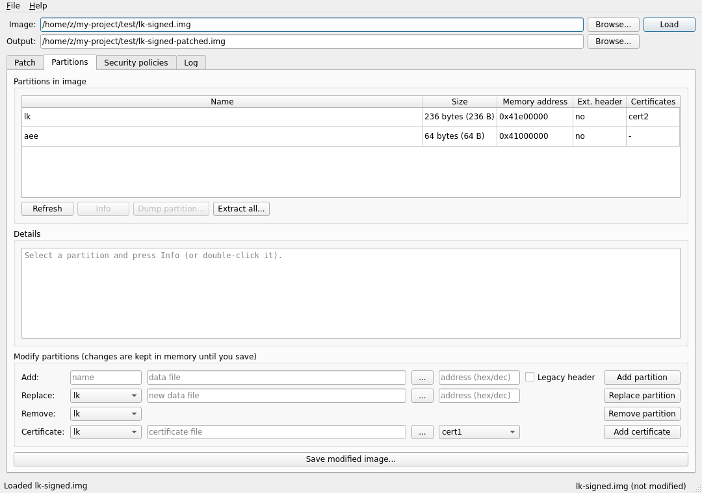
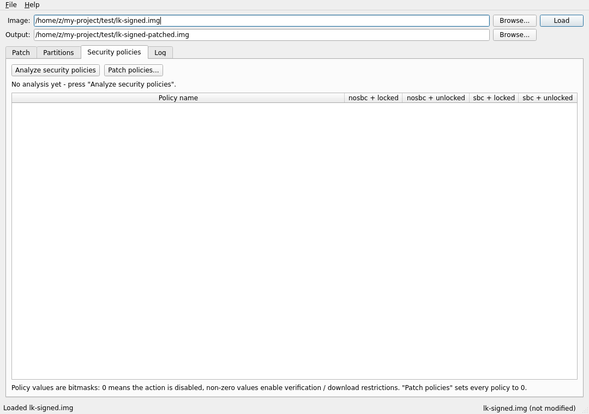

# lkpatcher GUI

A cross-platform (**Windows** and **Linux**) desktop GUI for
[lkpatcher](https://github.com/R0rt1z2/lkpatcher), the MediaTek LK (Little
Kernel) bootloader patcher by Roger Ortiz.

The GUI is a single Python file built with **PySide6 (Qt6)** and wraps the
lkpatcher library directly — every CLI option is available in the interface.

**Created by [ILYESwsa](https://github.com/ILYESwsa)**



---

## Features

| lkpatcher CLI option | Where in the GUI |
|---|---|
| `bootloader_image` | **Image** path at the top → *Load* |
| `-o, --output` | **Output** path at the top |
| `-j, --json-patches` | *Patch* tab → *Custom patches (JSON)* |
| `-c, --config` | *Patch* tab → *Configuration* → *Load config...* |
| `--export-config` | *Patch* tab → *Configuration* → *Export default config...* |
| `--category` / `--exclude` | *Patch* tab → category checkboxes (untick = exclude) |
| `--patch-policies` | *Patch* tab → *Options* → *Patch security policies* |
| `--cert-bypass [wrap\|override]` | *Patch* tab → *Certificate bypass* combo box |
| `--dry-run` | *Patch* tab → *Options* → *Dry run* |
| `--backup`, `--backup-dir` | *Patch* tab → *Options* → backup controls |
| `--log-level` | *Log* tab → *Level* combo box |
| `--log-file` | *Log* tab → *Save log...* |
| `-l, --list-partitions` | *Partitions* tab table |
| `-i, --partition-info` | *Partitions* tab → *Info* (or double-click a row) |
| `-d, --dump-partition` | *Partitions* tab → *Dump partition...* |
| *(extract everything)* | *Partitions* tab → *Extract all...* |
| `--add-partition` (+ `--partition-address`, `--partition-legacy`) | *Partitions* tab → *Add* row |
| `--replace-partition` | *Partitions* tab → *Replace* row |
| `--remove-partition` | *Partitions* tab → *Remove* row |
| `--add-certificate` (+ `--cert-type`) | *Partitions* tab → *Certificate* row |
| `--analyze-policies` | *Security policies* tab → *Analyze security policies* |

Extra conveniences over the CLI:

* Live log pane with adjustable verbosity (DEBUG...CRITICAL)
* Background workers — the window never freezes during long operations
* Automatic reload of the original image after patching, so you can tweak
  options and run again
* Window geometry is remembered between sessions
* Native look & feel on each platform (Windows / Linux desktop styles)

## Screenshots

| | |
|---|---|
|  |  |

---

## Requirements

* Python **3.10 or newer**
* [PySide6](https://pypi.org/project/PySide6/) (Qt 6)
* lkpatcher and its dependencies (liblk, pyasn1) — installed automatically
  in the steps below
* A desktop environment (Windows 10/11, or any mainstream Linux desktop)

## Installation — Linux

```bash
# 1. Get Python + pip if missing (Debian/Ubuntu):
sudo apt install python3 python3-pip python3-venv

# 2. Create a folder for the tool and a virtual environment:
mkdir -p lkpatcher-gui && cd lkpatcher-gui
cp /path/to/lkpatcher_gui.py .
python3 -m venv .venv
source .venv/bin/activate

# 3. Install the dependencies:
pip install PySide6-Essentials git+https://github.com/R0rt1z2/lkpatcher

# 4. Run:
python lkpatcher_gui.py
```

> `PySide6-Essentials` (~90 MB) contains everything this GUI needs. The
> full `PySide6` metapackage also works but pulls ~400 MB of extras
> (WebEngine etc.) you will never see here.

> **Note (externally-managed Python):** on newer distros (Debian 12+,
> Ubuntu 23.04+, Fedora 38+) `pip install` outside a venv is blocked
> ("externally-managed-environment"). Use the venv as shown above, or add
> `--break-system-packages` to the pip command, or install
> `python3-pyside6` from your distro's repositories and only
> `pip install --user --break-system-packages
> git+https://github.com/R0rt1z2/lkpatcher`.

Arch users: `python-pyside6` is available from the official repositories.

### Desktop launcher (optional)

Create `~/.local/share/applications/lkpatcher-gui.desktop`:

```ini
[Desktop Entry]
Type=Application
Name=lkpatcher GUI
Comment=MediaTek LK bootloader patcher
Exec=/full/path/to/lkpatcher-gui/.venv/bin/python /full/path/to/lkpatcher-gui/lkpatcher_gui.py
Icon=utilities-terminal
Terminal=false
Categories=Development;Utility;
```

## Installation — Windows

```powershell
# 1. Install Python 3.10+ from https://www.python.org/downloads/
#    (tick "Add python.exe to PATH" during setup)

# 2. Open PowerShell in the folder containing lkpatcher_gui.py and run:
py -m venv .venv
.venv\Scripts\activate
pip install PySide6-Essentials git+https://github.com/R0rt1z2/lkpatcher

# 3. Run:
python lkpatcher_gui.py
```

To launch it later without the console: create a shortcut to

```
...\lkpatcher-gui\.venv\Scripts\pythonw.exe ...\lkpatcher-gui\lkpatcher_gui.py
```

(`pythonw.exe` runs the GUI without a console window.)

## Offline installation (bundled wheels)

The zip bundle ships **pre-built wheels** under `wheels/` (plus the full
lkpatcher and liblk sources under `vendor/`). Installing from wheels skips
pip's *"Installing build dependencies ..."* step entirely — recommended,
especially on slow connections.

**Windows (PowerShell):**

```powershell
Expand-Archive lkpatcher-gui-bundle.zip
cd lkpatcher-gui
py -m venv .venv
.venv\Scripts\activate
pip install PySide6-Essentials pyasn1
pip install --no-deps .\wheels\liblk-3.2.0-py3-none-any.whl .\wheels\lkpatcher-4.3.0-py3-none-any.whl
python lkpatcher_gui.py
```

**Linux:**

```bash
unzip lkpatcher-gui-bundle.zip && cd lkpatcher-gui
python3 -m venv .venv && source .venv/bin/activate
pip install PySide6-Essentials pyasn1
pip install --no-deps ./wheels/liblk-3.2.0-py3-none-any.whl ./wheels/lkpatcher-4.3.0-py3-none-any.whl
python lkpatcher_gui.py
```

Notes:

* The wheels are pure-Python (`py3-none-any`) — the same files work on
  Windows, Linux and macOS.
* `--no-deps` is needed because lkpatcher's dependency list pins liblk to
  a git URL; liblk is installed from the wheel in the same command.
  `PySide6-Essentials` and `pyasn1` still come from PyPI — the only step
  that needs internet (~90 MB).
* If you prefer building from source, `vendor/` has everything:
  `pip install pyasn1 ./vendor/liblk`, then
  `pip install --no-deps ./vendor/lkpatcher`.

---

## Typical workflow

1. **Load** — pick your dumped bootloader image (`lk.img` / `bootloader.img`).
   The partition list, image version and patch categories are read
   automatically.
2. **Choose the output file** (pre-filled as `<name>-patched.img`).
3. **Select patch categories** — all boxes checked = apply everything.
   Hover a checkbox to see the exact needles/replacements it applies.
4. Optional: enable *Patch security policies* (disables verification),
   a *backup*, or pick a *Certificate bypass* mode. With a bypass mode
   selected the button reads **Patch + re-sign image**: the patches are
   applied first, and every partition whose contents changed is then
   re-signed so the bootloader still verifies it (use this for images
   with a `cert2`, e.g. most recent MTK bootloaders).
5. Click **Patch image** (or **Patch + re-sign image**). A summary dialog
   shows how many patches were applied; a `*.patch_report.json` is
   written next to the output.
6. Flash the result and (if needed) unlock **seccfg** with
   [mtkclient](https://github.com/bkerler/mtkclient).

If no patches apply, your device likely uses different code patterns —
open an upstream issue with your LK image, or write your own needles in a
custom patches JSON file and load it in the *Custom patches* row.

## Important notes (from upstream)

* To boot patched images you must unlock **seccfg** using
  [mtkclient](https://github.com/bkerler/mtkclient).
* **Always keep backups** of your original images — you are responsible
  for any damage to your device.
* If the device does not boot after unlocking with mtkclient, it probably
  uses SBC and is not supported.
* To learn how the patches work and how to write your own, read the
  [upstream guide](https://blog.r0rt1z2.com/patch-mediatek-bootloader-images-lk.html).

## Troubleshooting

| Problem | Fix |
|---|---|
| `ModuleNotFoundError: lkpatcher` | The virtual environment is not active, or step 3 was skipped. |
| `ImportError: libEGL.so.1` on Linux | Install your distro's OpenGL package (`sudo apt install libegl1`) — normally present on desktop systems. |
| pip stuck at *"Installing build dependencies ..."* | Not frozen: pip is silently downloading setuptools for a source build. Wait 1–5 min, or pre-install it (`pip install setuptools`) and retry with `--no-build-isolation` — or use the pre-built wheels from the bundle, which skip this step entirely. |
| GUI does not open over plain Wayland | Qt6 supports Wayland; if problems occur try `QT_QPA_PLATFORM=xcb python lkpatcher_gui.py` (requires XWayland). |
| "No needles found" / 0 patches applied | Your image uses different code patterns. Use a custom patches JSON (see upstream README) or open a device-specific issue upstream. |

## Changelog

* **1.0.2** — Add credits: the GUI author (ILYESwsa) is now shown in the
  About dialog, the startup log line and this README.
* **1.0.1** — Certificate bypass is now *patch + re-sign*: with a bypass
  mode selected the needles (and optionally the security policies) are
  applied first and every changed partition is re-signed afterwards.
  Previously the button re-signed only, which on a freshly loaded image
  found "nothing to re-sign" and produced an unpatched output. Also:
  needle patches are no longer discarded when *Patch security policies*
  is enabled, `cert2` is located by name instead of by list position
  (images without a `cert1` are handled correctly), and the CLI's
  `--cert-bypass` follows the same patch-then-resign order.
* **1.0.0** — Initial release.

## License

This GUI is licensed under the **GPL-3.0-or-later**, same as
[lkpatcher](https://github.com/R0rt1z2/lkpatcher) itself. lkpatcher was
created by Roger Ortiz (R0rt1z2); this GUI was created by
[ILYESwsa](https://github.com/ILYESwsa) as an unofficial third-party
frontend.
